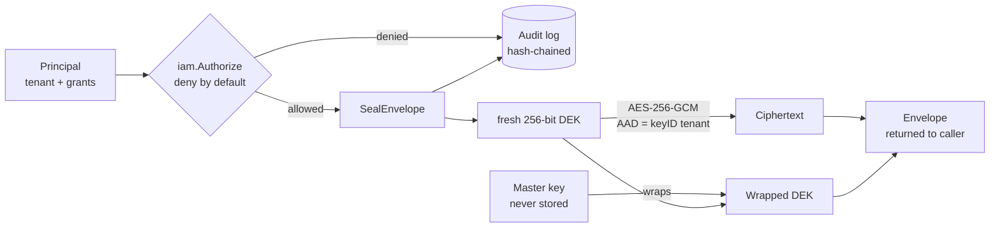

# Key Custody Service

**A Go key-management service built on envelope encryption: AES-256-GCM, a fresh data key per message, context-bound ciphertexts, deny-by-default authorization, and a hash-chained audit log.**

This is the service other services call before writing a secret to disk. A caller sends plaintext and a key ID; it gets back an envelope it can store anywhere. It gets the plaintext back only if its identity is allowed to use that key — and every attempt, allowed or denied, is recorded. The service never stores the caller's plaintext and never hands out raw key material.



## Security properties

| Property | How it's enforced |
|---|---|
| **Small blast radius** | A new 256-bit DEK is generated for every `SealEnvelope` call, so a leaked DEK exposes one envelope. |
| **Master key isolation** | The master key only ever wraps DEKs, is held in memory by the service, and is never written to the store. |
| **No nonce reuse** | Every `Seal` draws 12 fresh random bytes; nonces are never derived from state. |
| **No cross-context replay** | The key ID and tenant are bound as GCM additional authenticated data. An envelope sealed for `key\|tenantA` fails to open as `key\|tenantB`. |
| **No decryption oracle** | Any open failure returns the same `ErrDecrypt`, and the HTTP layer maps it to a generic `400`. |
| **Key hygiene** | Plaintext DEKs are zeroed with `defer` after sealing or opening. |
| **Tenant isolation** | A principal can never touch another tenant's key, regardless of grants — checked before grants are evaluated. |
| **Least privilege** | Grants list explicit actions (`encrypt`, `decrypt`, `create_key`, `rotate`) on explicit key IDs; `*` means any key *within the principal's tenant*. |
| **Accountability** | Every operation, including denials, is appended to a SHA-256 hash chain; `Verify()` returns the first entry that doesn't recompute. |

The reasoning behind these choices is written up in [ARCHITECTURE.md](ARCHITECTURE.md), and [THREAT_MODEL.md](THREAT_MODEL.md) covers DEK leaks, master-key compromise, nonce reuse, replay, and what the design explicitly does *not* defend against.

## Usage

```go
master := loadMasterKey() // 32 bytes, from an HSM or secrets manager in practice
kms := service.New(master, store.New(db), &audit.Log{})

alice := iam.Principal{
    ID: "alice", Tenant: "acme",
    Grants: []iam.Grant{{KeyIDs: []string{"*"}, Actions: []iam.Action{
        iam.CreateKey, iam.Encrypt, iam.Decrypt,
    }}},
}

_ = kms.CreateKey(alice, "wallet-signing")
env, _ := kms.Encrypt(alice, "wallet-signing", []byte("seed phrase"))
pt, _ := kms.Decrypt(alice, "wallet-signing", env)   // "seed phrase"

bob := iam.Principal{ID: "bob", Tenant: "other-co"}
_, err := kms.Decrypt(bob, "wallet-signing", env)      // iam.ErrForbidden, and audited
```

## Building it

Requires Go 1.21+ (uses the standard `slices` package). The repository doesn't include a `go.mod` yet; the packages import each other as `example.com/kcs/...`, so initialize the module with that path:

```bash
git clone https://github.com/AliAzamat/key-custody-service.git
cd key-custody-service
go mod init example.com/kcs
go build ./...
```

The store uses `database/sql` with `?` placeholders and the schema in `store/schema.sql` (written for SQLite). Bring your own driver, e.g. `modernc.org/sqlite` or `github.com/mattn/go-sqlite3`.

## Project layout

| Package | Responsibility |
|---|---|
| `crypto` | `Seal`/`Open` over AES-256-GCM; `SealEnvelope`/`OpenEnvelope` for the DEK/master-key hierarchy |
| `iam` | Principals, grants, and `Authorize` with tenant isolation |
| `service` | `KMS`: authorize → touch key material → audit, for `CreateKey`, `Encrypt`, `Decrypt` |
| `store` | Logical keys and versions over `database/sql`; `Rotate` adds a version without deleting old ones |
| `audit` | Append-only, hash-chained operation log |
| `api` | HTTP handler for `POST /encrypt` with error-to-status mapping that never echoes key material |
